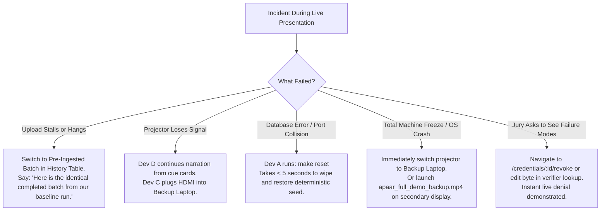

# Hackathon Venue-Failure & Offline Operation Plan

**Project**: APAAR Student Data Verification System for AICTE  
**Document**: Venue Contingency & Disaster Recovery Runbook  
**Milestone**: Milestone 7 (Feature Freeze & Final Rehearsals)  
**Classification**: Team Operational Reference  

---

## 1. Principles of Venue Resilience

Smart India Hackathon venues frequently suffer from:
1. Complete Wi-Fi loss, intermittent connectivity, or captive portals that block outbound traffic.
2. High DHCP contention preventing local port bridging.
3. Sudden laptop battery failure or display resolution issues with venue projectors.

The APAAR Verification System is **100% hermetic and air-gapped**:
* **Zero External Dependencies**: Zero CDNs, zero cloud APIs, zero external telemetry. All CSS, HTMX, Chart.js, and font definitions are vendored in `/web/static`.
* **Zero Cloud Auth**: Authentication is handled locally via bcrypt-hashed PostgreSQL sessions.
* **Two-Container Limit**: Only the Go application binary and PostgreSQL 16 are needed.

---

## 2. The Physical USB Emergency Bundle

The team maintains two identical USB drives (Demo Primary & Demo Secondary) containing:

```
[USB ROOT]
├── images/
│   └── apaar_offline_bundle.tar     (Pre-built Docker images: apaar_app:rc1 & postgres:16-alpine)
├── repo/
│   └── apaar-verify/                (Clean git clone at tag rc1 with go.mod vendoring)
├── env/
│   └── .env.demo                    (Pre-configured demo secrets)
├── binaries/                        (Pre-compiled standalone Windows/Linux binaries)
│   ├── server_windows_amd64.exe
│   ├── server_linux_amd64
│   └── seed_windows_amd64.exe
├── video/
│   ├── apaar_full_demo_backup.mp4   (5-minute narrated HD screen recording of complete demo path)
│   ├── failure_mode_tamper.mp4      (Clip: altered canonical payload fails signature)
│   └── failure_mode_revocation.mp4  (Clip: revoked consent instantly denies verifier)
└── deck/
    └── apaar_presentation_final.pdf (Pre-rendered presentation deck under 10 MB)
```

---

## 3. Step-by-Step Offline Cold Boot (No Internet Available)

### Procedure A: Docker-Enabled Machine (1 Minute to Running)
```bash
# 1. Load Docker images directly from USB drive
docker load -i /Volumes/USB/images/apaar_offline_bundle.tar

# 2. Copy repo directory to local workspace
cp -r /Volumes/USB/repo/apaar-verify ~/apaar-verify
cd ~/apaar-verify

# 3. Copy demo environment
cp /Volumes/USB/env/.env.demo .env

# 4. Start containers in detached mode (Zero download attempted)
docker compose up -d

# 5. Populate deterministic demo accounts
make seed

# 6. Verify health
curl -s http://localhost:8080/healthz
# Expected output: {"status":"healthy","database":"healthy"}
```

### Procedure B: Standalone Native Binary (Zero Docker Required)
If the host machine lacks Docker or Docker fails to start:
```bash
# 1. Start local PostgreSQL 16 service
pg_ctl -D /path/to/datadir start

# 2. Launch pre-compiled binary
./server_windows_amd64.exe

# 3. Open browser to localhost
open http://localhost:8080/login
```

---

## 4. Hardware Roles & Responsibilities

| Device | Primary Role | Hardware Specs | Assigned Team Member |
|---|---|---|---|
| **Primary Laptop** | Live Demo Driver (Web UI & Upload) | 16GB RAM, HDMI/Type-C Display Port | **Dev A** (Keyboard Driver) |
| **Backup Laptop** | Hot-Standby Clone (Mirror of Primary) | 16GB RAM, Pre-seeded Database | **Dev C** (Standby / Monitor) |
| **Smartphone** | QR Code Scanning (Public Landing Page) | iPhone / Android with Offline Camera | **Dev B** (Mobile Scan Operator) |
| **Speaker / Presenter**| Presentation & Verbal Explanation | Headset / Stage Mic | **Dev D** (Voice of the System) |

---

## 5. Live Presentation Failure Decision Tree



---

## 6. Pre-Flight Checklist (15 Minutes Before Stage Time)

* [ ] Laptop plugged into mains power; Windows Sleep / Screen Timeout set to **"Never"**.
* [ ] Display resolution locked to **1920x1080** (or 1280x720 projector native); Windows notifications set to **"Do Not Disturb"**.
* [ ] Chrome profile opened with all 4 role bookmarks pre-loaded in clean tabs (`DTU`, `COEP`, `Student`, `Verifier`).
* [ ] Passwords pre-filled on login screen; presenter never types passwords live.
* [ ] Terminal open at project root with `make smoke` and `make reset` ready in command history (`Up Arrow`).
* [ ] Phone camera tested against local certificate QR code (`/credentials/:id/certificate`).

